# Zuari Framework Documentation Hub

> Master documentation index for the **Zuari (`@zuari/*`)** zero-Virtual-DOM reactive framework, modular monorepo architecture, Apple Liquid Glass design system, AI-native workflow, and developer automation tools.

---

## Documentation Map

### Preserved Core Guides

- [Development Workflow & Product Architecture](./DEVELOPMENT_WORKFLOW.md) — Feature-first workspace boundaries (`src/app/`, `src/features/<feature>/`, `src/api/`), `modular-product` starter, and repository discipline commands.
- [GUI Design Recipes (Aether & Liquid Glass)](./GUI_DESIGN_RECIPES.md) — Practical starter patterns for `studio` / `noir` themes, `createDesignPresets`, `@zuari/recipes/aether.css`, data telemetry primitives (`createSparkline`, `createRadialGauge`, `createSelectionBar`), and visual hierarchy rules.
- [Playground Experience Plan](./PLAYGROUND_EXPERIENCE_PLAN.md) — Interactive feature tour roadmap (`Signal Circuit`, `Motion Forge`, `Scale Bench`, `Hardware Deck`, `Spatial Field`, `Memory Bridge`, `Color Lab`), reduced-motion policy, and playground folder structure.

### Architecture & Modular Packaging

- [01 — Modular Monorepo Architecture](./architecture/01-modular-monorepo.md) — Zero-monolith layering across all 27 `@zuari/*` workspace packages, `"sideEffects": false` tree-shaking guarantees, ESM conventions, and granular subpath exports.
- [02 — Package Management CLI (`zuari:pkg`)](./architecture/02-package-management-cli.md) — Composing minimal or domain-specific apps using `pnpm run zuari:pkg`, curated installation profiles, subpath import strategy, and external project adoption.

### Design System & Optical Engineering

- [01 — Apple Liquid Glass Optical Material Spec](./design-system/01-apple-liquid-glass.md) — Optical tokens (`--nova-color-surface-floating`, `--nova-color-specular-highlight`, `--zuari-glass-blur`, `--zuari-glass-saturation`, `--zuari-glass-rim-shadow`), `studio` / `noir` themes, `surface: 'liquid'` & `'frosted'`, spectral tints, and border pairing.
- [02 — Contrasting Boxiness & 5-Plane Placement Matrix](./design-system/02-contrasting-boxiness-and-planes.md) — Lightness-stop separation, 1px structural borders, visual chunking, the 5-Plane Placement Matrix (`Surface`, `Dock`, `Drawer`, `Command`, `Ambient`), the Resemblance Rule, and `@zuari/glyphs` vector iconography.

### AI-Native Workflow & Automation

- [01 — AI Agent Automation & Subagents](./ai-workflow/01-agent-automation-and-subagents.md) — Using `@zuari/mcp` architecture advisor tools, `@zuari/ai` prototyping primitives, strict zero-VDOM coding rules, parallel subagent delegation, and `AGENTS.md` synchronization.
- [01 — Developer Scripts & CLI Reference](./automation/01-dev-scripts-guide.md) — Full flag, subcommand, and exit-code reference for all 7 repository scripts in `scripts/`.

---

## 27-Package Ecosystem Topology

All 27 workspace packages in `packages/*` are organized into six architectural tiers with acyclic downward dependencies:

```mermaid
flowchart TD
    subgraph T1["Tier 1 - Core Reactivity and DOM"]
        SIG["@zuari/signals"]
        DOM["@zuari/dom"]
        CORE["@zuari/core (Unified Barrel)"]
    end

    subgraph T2["Tier 2 - Design System and UI/UX"]
        TOK["@zuari/tokens"]
        REC["@zuari/recipes (Scoped CSS)"]
        GLY["@zuari/glyphs (24x24 SVG and Lucide)"]
        HDL["@zuari/headless"]
        PRE["@zuari/presets"]
        UI["@zuari/ui"]
    end

    subgraph T3["Tier 3 - Spatial and Hardware"]
        SPA["@zuari/spatial"]
        HW["@zuari/hardware"]
    end

    subgraph T4["Tier 4 - 2026-2028 Platform Primitives"]
        RTR["@zuari/router"]
        SSR["@zuari/ssr"]
        SYNC["@zuari/sync"]
        AI["@zuari/ai"]
        GPU["@zuari/webgpu"]
        SYS1["@zuari/system-one"]
        QNT["@zuari/quantum"]
    end

    subgraph T5["Tier 5 - Developer and AI Tooling"]
        MCP["@zuari/mcp"]
        DEV["@zuari/devtools"]
        CZU["create-zuari"]
        VITE["@zuari/vite-plugin"]
        VSC["vscode-zuari"]
    end

    subgraph T6["Tier 6 - Native and Polyglot Targets"]
        WASM["@zuari/wasm"]
        WIT["@zuari/wit"]
        KT["@zuari/kotlin"]
        LUA["@zuari/lua"]
    end

    SIG --> DOM
    SIG --> TOK
    SIG --> HDL
    TOK --> PRE
    SIG --> PRE
    SIG --> UI
    DOM --> UI
    HDL --> UI
    GLY --> UI
    REC --> UI

    SIG --> SPA
    SIG --> HW

    SIG --> RTR
    SIG --> SSR
    DOM --> SSR
    SIG --> SYNC
    SIG --> AI
    DOM --> AI
    GLY --> AI
    SIG --> GPU
    SIG --> SYS1
    DOM --> SYS1
    SIG --> QNT

    SIG --> DEV
    DOM --> DEV
    SIG --> VITE

    SIG --> WASM
    SIG --> WIT
    WASM --> WIT
    SIG --> KT
    SIG --> LUA

    SIG --> CORE
    DOM --> CORE
    TOK --> CORE
    GLY --> CORE
    HDL --> CORE
    PRE --> CORE
    UI --> CORE
    SPA --> CORE
    HW --> CORE
    RTR --> CORE
    SYNC --> CORE
    AI --> CORE
    GPU --> CORE
    SYS1 --> CORE
    QNT --> CORE
    DEV --> CORE
    WASM --> CORE
    WIT --> CORE
    KT --> CORE
    LUA --> CORE
```

---

## CLI Quick-Reference Table

| Command | Script Path | Purpose | Guide |
| :--- | :--- | :--- | :--- |
| `pnpm test` | Workspace `vitest` | Run all package unit and DOM tests | [DEVELOPMENT_WORKFLOW.md](./DEVELOPMENT_WORKFLOW.md) |
| `pnpm build` | Workspace `tsup` / build | Build all workspace packages | [01-modular-monorepo.md](./architecture/01-modular-monorepo.md) |
| `pnpm dev` | Playground `vite` | Start the interactive Zuari playground | [PLAYGROUND_EXPERIENCE_PLAN.md](./PLAYGROUND_EXPERIENCE_PLAN.md) |
| `pnpm run zuari:pkg` | `scripts/zuari-pkg.mjs` | List, inspect, preset-install, add, or remove `@zuari/*` packages | [02-package-management-cli.md](./architecture/02-package-management-cli.md) |
| `pnpm run doctor` | `scripts/doctor.mjs` | Verify package manifests, subpath export parity, AI rules, and docs | [01-dev-scripts-guide.md](./automation/01-dev-scripts-guide.md) |
| `pnpm run sync:rules` | `scripts/sync-ai-rules.mjs` | Sync `CLAUDE.md` and `.cursorrules` from `AGENTS.md` (`--check` supported) | [01-agent-automation-and-subagents.md](./ai-workflow/01-agent-automation-and-subagents.md) |
| `pnpm run new:module` | `scripts/new-module.mjs` | Scaffold a `@zuari/ui/*` or `@zuari/hardware/*` submodule or standalone package | [01-dev-scripts-guide.md](./automation/01-dev-scripts-guide.md) |
| `pnpm audit:modules` | `scripts/dev/audit-modules.mjs` | Report oversized files across `packages` and `playground/src` | [01-dev-scripts-guide.md](./automation/01-dev-scripts-guide.md) |
| `pnpm docs:search` | `scripts/dev/search-docs.mjs` | Ranked keyword search across repository Markdown docs | [01-dev-scripts-guide.md](./automation/01-dev-scripts-guide.md) |
| `pnpm research:reuse` | `scripts/dev/research-reuse.mjs` | Read-only pattern scanner for external repositories | [01-dev-scripts-guide.md](./automation/01-dev-scripts-guide.md) |
